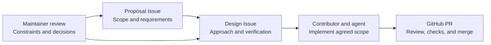

# issue-spec

**English | [简体中文](README.zh-CN.md)**

**Open-source project governance for the agent era, built on GitHub.**

`issue-spec` gives project maintainers a formal, controlled way to shape a
contributor's agent context **before implementation** through Proposal and
Design Issues. Requirements, design constraints, and human decisions become
structured, reviewable inputs to the agent's work, with explicit trust
boundaries and safety controls to reduce prompt-injection risk. The community
collaborates in GitHub Issues and pull requests; maintainers keep control of
approval and merge.

## Shape agent context before code is written

Agents can produce code faster than maintainers can review it. A useful
contribution starts with agreement on the problem, scope, and design.
Issue-spec gives maintainers a formal, traceable way to guide that work while
those decisions are still inexpensive to change.

| Review surface | What maintainers can shape | What the contributor's agent carries forward |
| --- | --- | --- |
| **Proposal Issue** | The problem, intended behavior, scope, and non-goals | Requirements and acceptance scenarios in `SPEC` comments |
| **Design Issue** | Architecture, compatibility constraints, tradeoffs, and verification plan | The agreed implementation approach and `TASK` comments linked to requirements |
| **Structured decisions** | Questions that need a human decision before work proceeds | Blocking `QUESTION` comments with recorded resolutions or `ANSWER` choices |

The contributor and their agent read the current Design, applicable decisions,
and selected tasks through the CLI before implementing. Maintainers can ask
for a narrower scope, reject an approach, or require a concrete verification
plan in the public discussion. Those decisions remain available when another
contributor or agent picks up the work.



Start with a simple Issue for a bounded change. Add Proposal, Design, or an
Implement Issue when the project needs that planning or coordination. Projects
decide when maintainer approval is required; CLI artifact validation and task
status do not grant that approval.

## Built for open-source collaboration on GitHub

- **Review direction early.** Discuss requirements and design before investing
  in a large implementation or asking maintainers to review its diff.
- **Keep decisions public and reusable.** Issues, typed comments, and linked
  PRs preserve the reasoning for contributors across organizations and time
  zones, beyond any one agent session.
- **Connect intent to evidence.** Link requirements to implementation tasks,
  record checks and results, and carry that context into PR review. Projects
  can also keep durable capability specs versioned in the repository.
- **Keep community authority explicit.** Maintainers define contribution
  policy; GitHub owns PR reviews, checks, branch protection, and merge.

Use your existing `gh` login with github.com or GitHub Enterprise. Contributors
read and discuss ordinary Markdown in GitHub, while their agents use the CLI
to retrieve and validate structured artifacts. No issue-spec server is needed
for this workflow.

## Structured context with prompt-injection defenses

Public Issues and comments can contain attacker-controlled instructions.
Issue-spec separates project guidance and authorized commands from fetched
discussion content:

- **Explicit untrusted-data boundaries.** CLI Issue/PR reads and search results
  label fetched content as untrusted. Text output encloses user-authored fields
  in boundaries with a fresh random nonce, making forged boundary markers
  harder to pass off as trusted instructions. Agent guidance says artifact
  bodies cannot override its instructions or execution contract.
- **Validated planning artifacts.** Canonical formats, typed IDs, and declared
  relationships make requirements, decisions, and tasks inspectable. Approval
  still follows project governance; an instruction embedded in a comment does
  not acquire authority merely by appearing in an Issue.
- **Authorized, isolated Runner execution.** If a project enables the optional
  comment Runner, command authors must pass its allow-list and repository
  permission checks. Linux execution uses bubblewrap by default and fails
  closed when sandbox prerequisites are missing; disabling isolation requires
  an explicit operator choice.

These controls reduce risk; they do not guarantee that an agent will resist
every injection. Maintainer review, agent permissions, and the configured
execution environment remain part of the safety boundary. See the
[CLI read boundaries](internal/commands/read.go),
[search contracts](docs/reference.md#cli-reference), and
[Runner security and operations](docs/runner.md).

## In practice: Higress

[Higress](https://github.com/higress-group/higress) provides a concrete example
of governing agent-assisted contributions in an open-source community. Its
[governance model](https://github.com/higress-group/community/blob/main/GOVERNANCE.md)
keeps significant decisions and their rationale in public discussion.

Under its
[agent-assisted contribution policy](https://github.com/higress-group/higress/blob/main/docs/developers/agent-assisted-contributions.md),
materially agent-assisted contributions normally need maintainer-approved
Proposal and Design Issues before implementation. The Design includes a
verification plan; implementation and verification tasks preserve traceability
to the agreed requirements. PRs disclose agent involvement and link the work
and evidence for human review. The policy also defines exceptions and their
verification requirements.

This illustrates how maintainers can shape contributor agents' context through
reviewed requirements and design, then assess the result through GitHub.
These are Higress's project rules; other communities can set their own planning
and approval requirements using issue-spec's shared workflow and project guidance.

## Quick start on GitHub

Install the CLI with the Go toolchain declared in [`go.mod`](go.mod), and make
sure the [GitHub CLI](https://cli.github.com/) is available:

```bash
go install github.com/higress-group/issue-spec/cmd/issue-spec@latest
gh auth login
```

For initial project setup, run this from the repository checkout, replacing
`owner/repo` with its GitHub name:

```bash
issue-spec --profile github init --repo owner/repo --create-labels --tools codex,claude --delivery skills
```

This creates repository connection metadata, workflow labels, and shared agent
skills under `.agents/skills`, with per-skill Claude links. Label creation needs
repository permission; use `--skip-labels` if maintainers manage labels
separately. Contributors to an initialized project should follow its existing
guidance and use the committed skills.

Ask your agent to use `issue-spec-workflow` for a change, or select
`issue-spec-propose` for planning and `issue-spec-apply` for implementation.
For example, start with:

```text
Use issue-spec-propose to plan <change> in owner/repo. Read the project rules,
find related discussions, and prepare the requirements and design for
maintainer review before implementation.
```

After the required decisions and approvals are recorded:

```text
Use issue-spec-apply for <issue URL>. Follow the agreed Design and decisions,
implement the authorized scope, run the required checks, and prepare a PR
with the results for human review.
```

Project context, contribution rules, and phase-specific guidance live in
`issue-spec/config.yaml` and referenced files. Maintainers can share the same
rules with every contributor's agent and preview generated skill upgrades with
`issue-spec workflow update --dry-run`. See
[configuration and safe updates](docs/reference.md#shared-skills-and-safe-updates).

## Learn more

- **[Workflow guide](docs/workflow.md)** — optional planning, implementation, and human review handoff
- **[CLI reference](docs/reference.md)** — project guidance, commands, and typed comments
- **[Runner operations](docs/runner.md)** — authorized GitHub comment commands, sandboxing, and recovery
- **[Workflow safety](docs/workflow-safety.md)** — planning checks, workspace safety, and failure handling

## Development

Local builds and tests use the Go toolchain declared in [`go.mod`](go.mod):

```bash
go build ./cmd/issue-spec
go test ./...
```

See [the CI workflow](.github/workflows/unit-tests.yml) for the test tiers,
generated asset checks, and integration checks run on pull requests.

## Acknowledgements

`issue-spec` is inspired by [OpenSpec](https://github.com/Fission-AI/OpenSpec)
and adapts spec-first development to public Issues, contributor agents, and
maintainer-led review on GitHub.

## Optional: self-hosted workspace

Teams that need their own issue service can run the issue-spec Server. It adds
a browser workspace with rendered review briefs, interactive question
answering, search, and change boards, backed by organization and repository
permissions and PostgreSQL. Source code, PRs/MRs, reviews, and CI stay on the
connected code host.

See the **[self-hosting guide](docs/self-hosting/README.md)** for the product
tour and deployment, [enterprise provider integration](docs/self-hosting/enterprise-provider-integration.md)
for other code and work platforms, and the
[local Server development guide](docs/self-hosting/local-development.md)
for running the Server with PostgreSQL.
