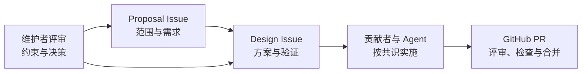

# issue-spec

**[English](README.md) | 简体中文**

**面向 Agent 时代的开源项目治理，基于 GitHub 协作。**

`issue-spec` 让项目维护者在**实现开始之前**，通过 Proposal / Design Issue 以形式化、可控的方式干预贡献者 Agent 的上下文。需求、设计约束与人工决策成为结构化、可评审的实施依据，并通过显式信任边界等安全防护降低提示词注入风险。社区直接在 GitHub Issue 和 PR 中协作，批准与合并仍由维护者掌握。

## 在写代码之前，塑造贡献者 Agent 的上下文

Agent 生成代码的速度可以远超维护者评审代码的速度。有价值的贡献首先需要对问题、范围和设计达成共识。issue-spec 让维护者在调整成本还低的阶段，就能以形式化、可追溯的方式引导贡献方向。

| 评审载体 | 维护者可以干预什么 | 贡献者 Agent 继续工作时依据什么 |
| --- | --- | --- |
| **Proposal Issue** | 要解决的问题、预期行为、范围与非目标 | `SPEC` 评论中的需求与验收场景 |
| **Design Issue** | 架构、兼容性约束、方案取舍与验证计划 | 已达成共识的实施方案，以及关联需求的 `TASK` 评论 |
| **结构化决策** | 继续工作前需要人类拍板的问题 | 阻塞型 `QUESTION` 评论，以及记录下来的解决结论或 `ANSWER` 选择 |

贡献者及其 Agent 在实现前，通过 CLI 读取当前 Design、适用的决策和选定任务。维护者可以在公开讨论中要求收窄范围、否决某种方案，或补充具体的验证计划。即使换一位贡献者或 Agent 接手，这些决策也能继续作为工作依据。



范围明确的小改动可以从一个普通 Issue 开始；项目需要相应规划或协调时，再引入 Proposal、Design 或 Implement Issue。是否必须先获得维护者批准，由项目规则决定；CLI 的产物校验和任务状态本身不代表批准。

## 围绕 GitHub 上的开源协作

- **提前评审方向。** 在投入大量实现、提交大篇幅 diff 之前，先讨论清楚需求与设计。
- **让决策公开、可复用。** Issue、类型化评论和关联 PR 保留决策理由，让跨组织、跨时区的贡献者共享上下文，超越某一次 Agent 会话。
- **把需求与证据关联起来。** 从需求关联到实施任务，记录检查过程与结果，供 PR 评审使用；项目也可以把长期能力规格保存在仓库中，随代码一起版本化。
- **明确社区的决策权。** 维护者制定贡献规则，GitHub 承载 PR Review、检查、分支保护与合并。

直接复用现有 `gh` 登录，对接 github.com 或 GitHub Enterprise。贡献者在 GitHub 中阅读和讨论普通 Markdown，Agent 通过 CLI 读取、校验结构化产物。这套流程无需部署 issue-spec Server。

## 结构化上下文与提示词注入防护

公开 Issue 和评论可能包含攻击者编写的指令。issue-spec 将项目指导规则、经过授权的命令与读取到的讨论内容分开处理：

- **显式标记不可信数据。** CLI 读取 Issue / PR、检索讨论时，会将远端内容标为不可信数据；文本输出用每次随机生成的 nonce 边界包裹用户撰写的字段，提高伪造边界、冒充可信指令的难度。Agent 指引明确要求：产物正文不能覆盖 Agent 的指令或执行契约。
- **校验规划产物。** 规范格式、类型化 ID 与声明的关联关系，让需求、决策和任务可以被检查。批准仍遵循项目治理规则，评论中的一段指令不会因为出现在 Issue 里就自动获得权限。
- **Runner 执行有授权与隔离。** 项目按需启用评论 Runner 时，命令发起者必须通过允许名单和仓库权限检查。Linux 默认使用 bubblewrap，缺少沙箱前提条件时拒绝执行；关闭隔离必须由运维显式选择。

这些措施用于降低风险，并不保证 Agent 能抵御所有注入；维护者评审、Agent 权限与实际执行环境仍是安全边界的一部分。实现和使用说明见 [CLI 读取边界](internal/commands/read.go)、[检索与命令契约](docs/reference.zh-CN.md#cli-参考)及 [Runner 安全与运维](docs/runner.zh-CN.md)。

## 实践参考：Higress

[Higress](https://github.com/higress-group/higress) 展示了开源社区如何治理 Agent 辅助贡献。其[治理规则](https://github.com/higress-group/community/blob/main/GOVERNANCE.md)要求在公开讨论中保留重要决策及理由。

根据其 [Agent 辅助贡献政策](https://github.com/higress-group/higress/blob/main/docs/developers/agent-assisted-contributions.md)，有实质性 Agent 参与的贡献通常需要先取得维护者对 Proposal 和 Design Issue 的批准，再开始实现。Design 包含验证计划，实施与验证任务保持到已确认需求的可追溯性；PR 披露 Agent 参与情况，并关联工作记录和证据，供人类评审。该政策也明确了例外情况及对应的核验要求。

这个实践体现了维护者如何通过评审后的需求与设计塑造贡献者 Agent 的上下文，再通过 GitHub 评审成果。这些是 Higress 的项目规则；其他社区可以利用 issue-spec 的通用工作流和项目补充指引，制定适合自己的规划与批准要求。

## 在 GitHub 上快速开始

使用 [`go.mod`](go.mod) 声明的 Go 工具链安装 CLI，并准备好 [GitHub CLI](https://cli.github.com/)：

```bash
go install github.com/higress-group/issue-spec/cmd/issue-spec@latest
gh auth login
```

首次接入项目时，在仓库检出目录中执行以下命令，将 `owner/repo` 替换为实际的 GitHub 仓库名：

```bash
issue-spec --profile github init --repo owner/repo --create-labels --tools codex,claude --delivery skills
```

该命令创建仓库连接元数据、工作流标签和 `.agents/skills` 下的共享技能，并为 Claude 创建逐技能链接。创建标签需要相应仓库权限；若标签由维护者单独管理，可使用 `--skip-labels`。向已初始化的项目贡献时，应遵循其现有指引，使用仓库已提交的技能。

让 Agent 使用 `issue-spec-workflow` 推进变更，或分别选择 `issue-spec-propose` 进行规划、`issue-spec-apply` 进行实现。例如，先提出：

```text
使用 issue-spec-propose 为 owner/repo 规划 <变更>。先阅读项目规则、检索相关讨论，
在实现前准备好需求与设计，交给维护者评审。
```

所需决策与批准记录完成后，再继续：

```text
使用 issue-spec-apply 处理 <Issue URL>。遵循已达成共识的 Design 与决策，
实现授权范围，执行要求的检查，并准备附有结果的 PR 供人类评审。
```

项目上下文、贡献规则和各阶段指引保存在 `issue-spec/config.yaml` 及其引用文件中。维护者可以让每位贡献者的 Agent 读取同一套规则，并用 `issue-spec workflow update --dry-run` 预览生成技能的升级。详见[配置与安全升级](docs/reference.zh-CN.md#共享技能项目补充与安全升级)。

## 了解更多

- **[工作流指南](docs/workflow.zh-CN.md)** —— 按需规划、实施与人工评审交接
- **[CLI 参考](docs/reference.zh-CN.md)** —— 项目指引、命令和类型化评论
- **[Runner 运维](docs/runner.zh-CN.md)** —— GitHub 评论命令授权、沙箱与恢复
- **[工作流安全](docs/workflow-safety.md)** —— 规划检查、工作区安全与失败处理

## 开发

本地构建与测试使用 [`go.mod`](go.mod) 中声明的 Go 工具链：

```bash
go build ./cmd/issue-spec
go test ./...
```

PR 上运行的测试分层、生成资源检查与集成检查见 [CI 工作流](.github/workflows/unit-tests.yml)。

## 致谢

`issue-spec` 受 [OpenSpec](https://github.com/Fission-AI/OpenSpec) 启发，将 spec 优先的开发方式应用于公开 Issue、贡献者 Agent，以及 GitHub 上由维护者主导的评审。

## 可选：自托管工作台

需要自有 Issue 服务的团队可以部署 issue-spec Server，获得包含评审简报、交互式问题作答、检索和变更看板的浏览器工作台，以及组织与仓库权限、PostgreSQL 持久化存储。源代码、PR/MR、Review 和 CI 继续留在接入的代码托管平台。

产品展示与部署见**[自托管指南](docs/self-hosting/README.zh-CN.md)**，接入其他代码与工作平台见[企业平台集成](docs/self-hosting/enterprise-provider-integration.md)，连接 PostgreSQL 启动 Server 见[本地 Server 开发指南](docs/self-hosting/local-development.zh-CN.md)。
